\# 🚀 SkillGap AI – Intelligent Skill Gap Analysis Platform


An intelligent web-based platform that helps students identify skill gaps between their current technical skills and the skills required for their desired job roles.


SkillGap AI analyzes user skills, identifies missing skills, evaluates proficiency gaps, and recommends learning resources to help students become industry-ready.


\## 🎯 Problem Statement


Many students struggle to understand which technical skills they need to develop to meet industry requirements. They often lack a clear roadmap to bridge the gap between their current knowledge and their career goals.


\*\*SkillGap AI aims to solve this problem\*\* by providing personalized skill gap analysis and learning recommendations.


\## ✨ Key Features


\- \*\*Skill Assessment:\*\* Add and manage technical skills with proficiency levels.

\- \*\*Job Role Selection:\*\* Explore desired career roles and their required skills.

\- \*\*Skill Gap Analysis:\*\* Compare existing skills with job requirements.

\- \*\*Proficiency Gap Detection:\*\* Identify skills that need improvement.

\- \*\*Match Percentage:\*\* View your compatibility with a selected job role.

\- \*\*Learning Recommendations:\*\* Get resources to improve missing or weak skills.

\- \*\*AI-Powered Assistance:\*\* Integrate AI capabilities to support personalized learning.

\- \*\*Modern Dashboard:\*\* Track skill development through an interactive interface.


\## 🛠️ Technology Stack


| Layer | Technologies |

|---|---|

| Frontend | React.js, Vite, JavaScript |

| Backend | Java, Spring Boot |

| Database | MySQL |

| ORM | Spring Data JPA, Hibernate |

| API | REST APIs |

| Authentication | JWT |

| AI | Ollama, Qwen3 |

| API Testing | Postman |

| Version Control | Git, GitHub |


\## 🏗️ Project Architecture


```text

&#x20;                SKILLGAP AI

&#x20;                     |

&#x20;         +-----------+-----------+

&#x20;         |                       |

&#x20;      Frontend                 Backend

&#x20;    React + Vite             Spring Boot

&#x20;         |                       |

&#x20;         |                  REST APIs

&#x20;         |                       |

&#x20;         +-----------+-----------+

&#x20;                     |

&#x20;                  MySQL

&#x20;                     |

&#x20;              Data Management


&#x20;             AI Integration

&#x20;               Ollama

&#x20;                Qwen3
 
```


## 📸 Application Screenshots

### 1. Dashboard
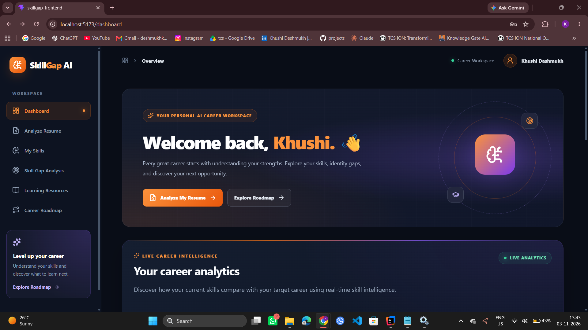
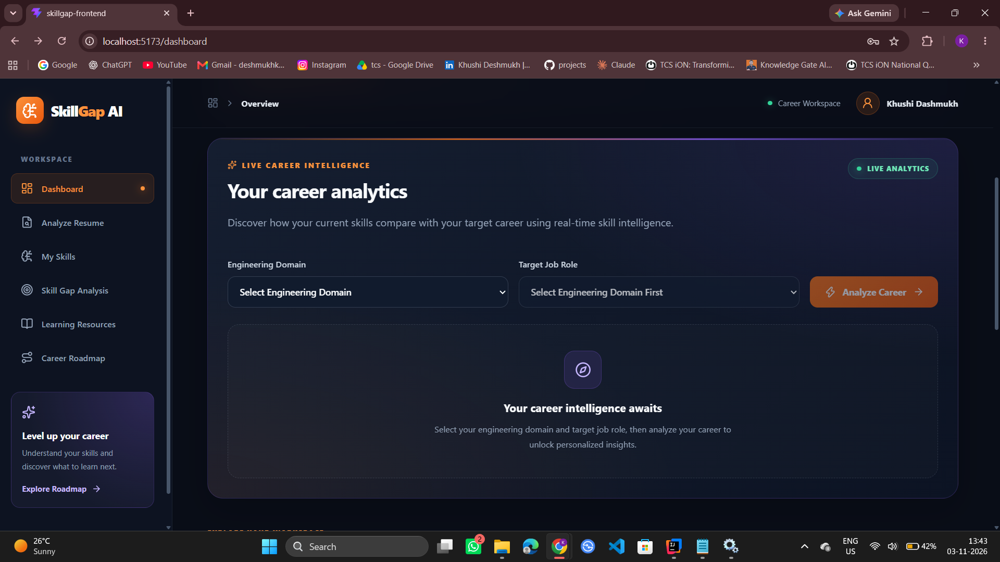
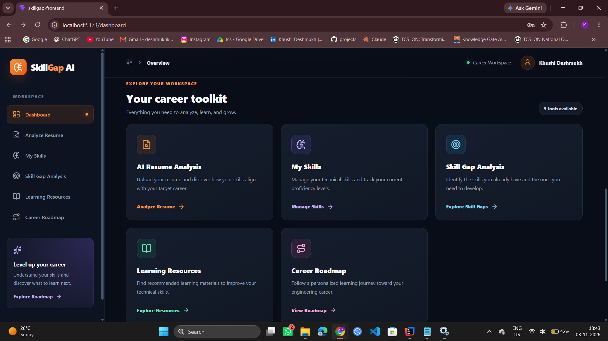

### 2. Analyze Resume
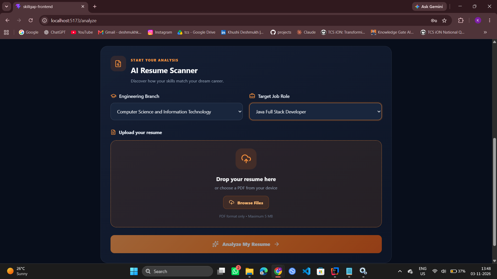
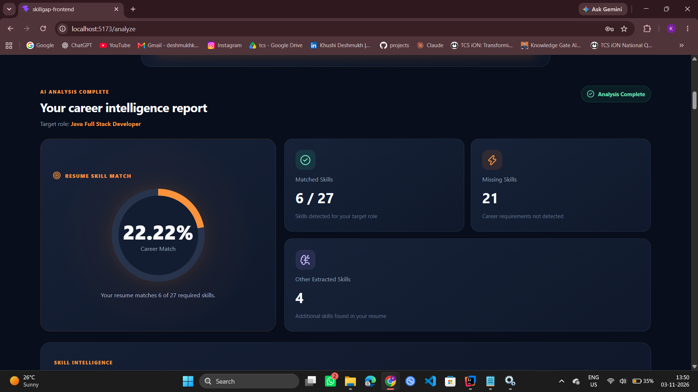
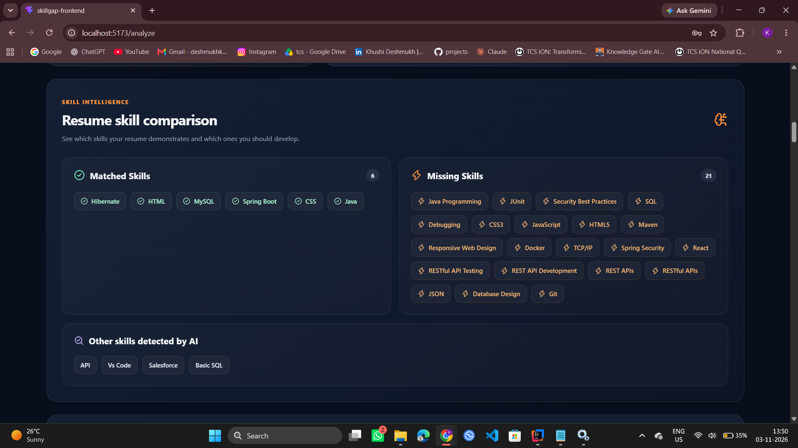

### 3. My Skills
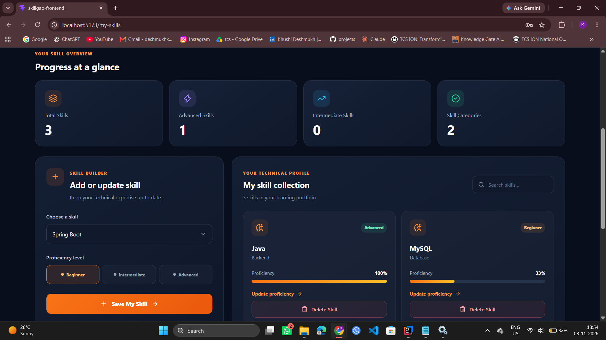

### 4. Skill Gap Analysis
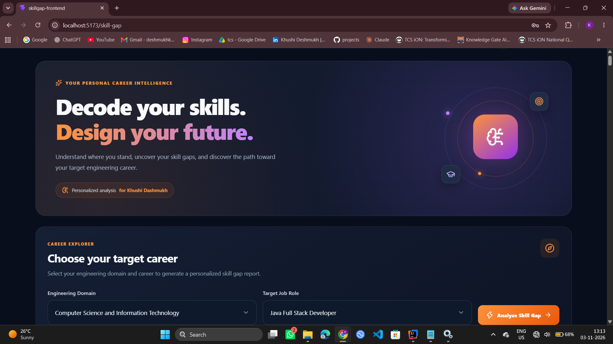
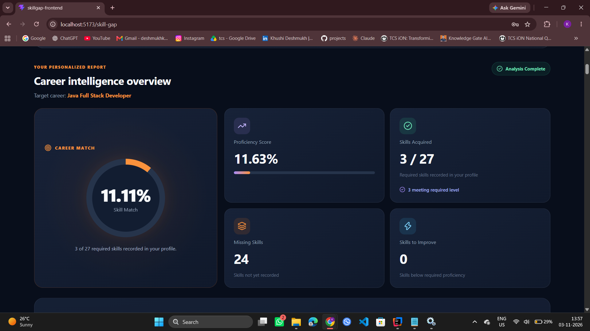

### 5. Learning Resources
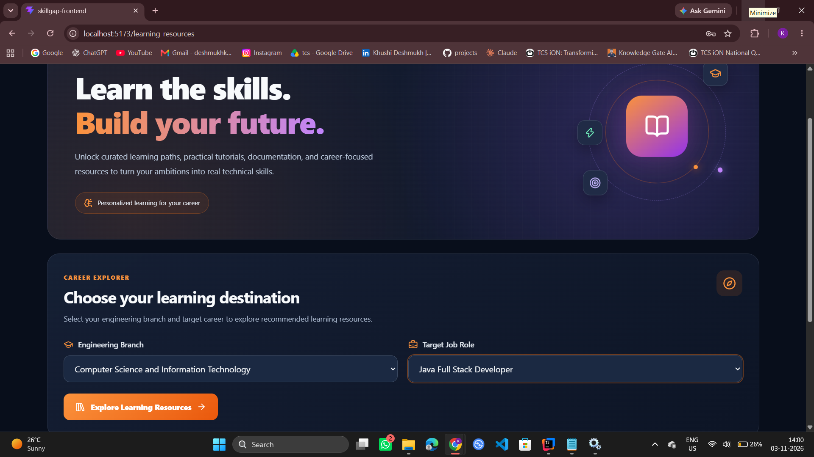
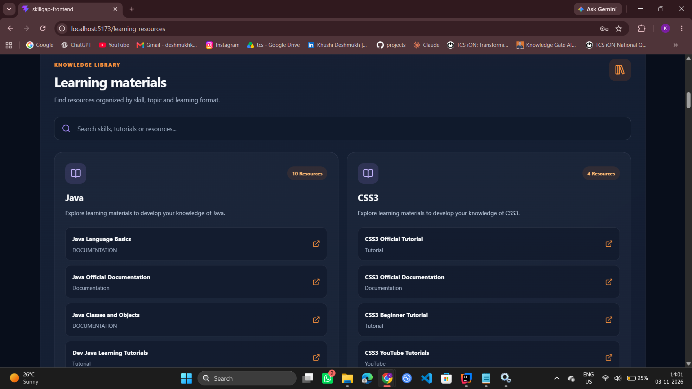

### 6. Career Roadmap
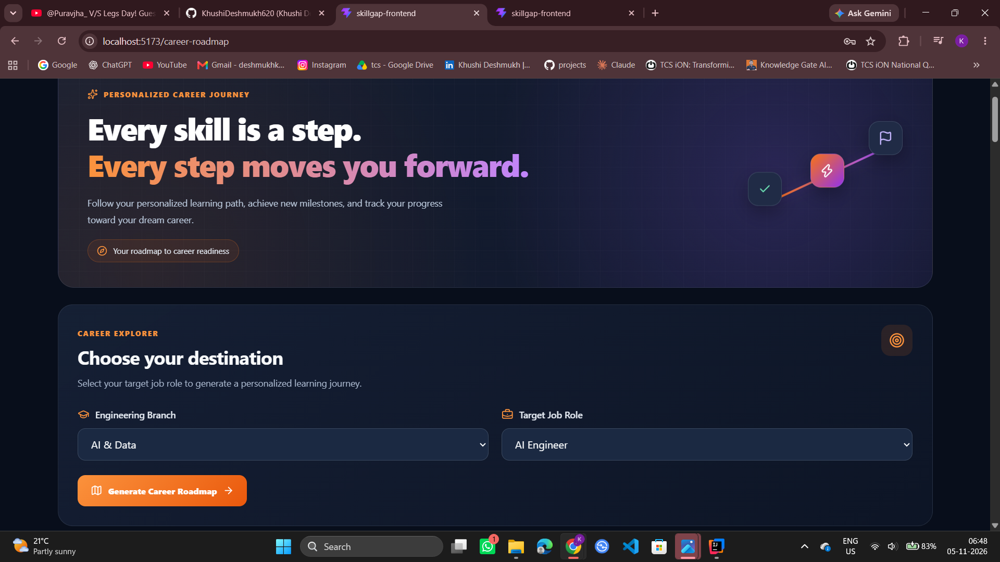
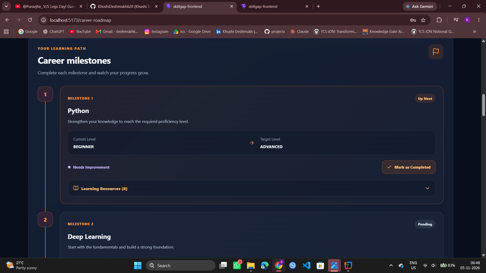


\## 📂 Project Structure


```text

SkillGap-AI/

│

├── backend/

│   ├── src/

│   ├── .mvn/

│   ├── pom.xml

│   ├── mvnw

│   └── mvnw.cmd

│

├── frontend/

│   ├── public/

│   ├── src/

│   ├── package.json

│   ├── package-lock.json

│   └── vite.config.js

│

├── screenshots/

│

└── README.md

```


\## ⚙️ Getting Started


\### Prerequisites


Install the following before running the project:


\- Java JDK 21

\- Maven (or use the included Maven Wrapper)

\- Node.js and npm

\- MySQL

\- Ollama, if using the local AI integration


\### 1. Clone the Repository


```bash

git clone https://github.com/KhushiDeshmukh620/skillgap-backend.git

cd skillgap-backend

```


\### 2. Run the Backend


Configure your MySQL database and application environment settings.


Navigate to the backend folder:


```bash

cd backend

```


Run the Spring Boot application:


```bash

mvnw.cmd spring-boot:run

```


Backend default address:


`http://localhost:8080`


\### 3. Run the Frontend


Open another terminal:


```bash

cd frontend

npm install

npm run dev

```


Frontend default address:


`http://localhost:5173`


\### 4. AI Configuration


The AI integration uses Ollama with the Qwen3 model in the local development environment.


Install Ollama and configure the model before using AI-powered features.


\## 🔮 Future Enhancements


\- Personalized career roadmaps

\- Advanced AI-based skill recommendations

\- More job role and skill datasets

\- Progress tracking and skill improvement analytics

\- Cloud deployment and online accessibility


\## 👩‍💻 Developer


\*\*Khushi Deshmukh\*\*


B.Tech – Information Technology


Project: SkillGap AI – Intelligent Skill Gap Analysis Platform


\## ⭐ Support


If you find this project interesting, consider giving the repository a star!


\---


\*Built to help students understand their skill gaps and move closer to their career goals.\*

